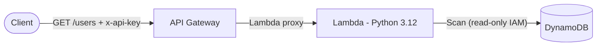

# AWS Serverless User API


A small, production-minded serverless REST API on AWS. It returns user records from **DynamoDB** through **API Gateway** and a **Python Lambda**, deployed with **AWS SAM**.

## Features

- `GET /users` with `limit` validation (1-100) and cursor-based pagination (`nextToken`)
- API key required, with throttling via an API Gateway usage plan
- Least-privilege IAM: the Lambda can only read the one users table
- Safe error handling: AWS error details stay in CloudWatch, never in responses
- Handles DynamoDB `Decimal` values and both REST (v1) and HTTP (v2) API event formats
- Unit-tested with `pytest` (no AWS account needed) and CI via GitHub Actions
- OpenAPI 3 spec included

## Architecture



More detail in [docs/architecture.md](docs/architecture.md).

## Project structure

```
.
├── src/
│   └── handler.py          # Lambda function
├── tests/
│   └── test_handler.py     # Unit tests (boto3 mocked)
├── docs/
│   ├── architecture.md
│   ├── architecture.mmd
│   └── security.md
├── .github/workflows/ci.yml
├── template.yaml           # AWS SAM template (API GW + Lambda + DynamoDB)
├── openapi.yaml            # API specification
├── .env.example
├── requirements.txt
└── requirements-dev.txt
```

## Prerequisites

- Python 3.12
- [AWS CLI](https://docs.aws.amazon.com/cli/latest/userguide/getting-started-install.html) configured (`aws configure`)
- [AWS SAM CLI](https://docs.aws.amazon.com/serverless-application-model/latest/developerguide/install-sam-cli.html)

## Run the tests

```bash
python -m venv .venv
source .venv/bin/activate        # Windows: .venv\Scripts\activate
pip install -r requirements-dev.txt
pytest
```

## Deploy

```bash
sam validate --lint
sam build
sam deploy --guided
```

`--guided` asks for a stack name and region, then saves your answers to `samconfig.toml` (git-ignored). The stack outputs print the API URL and table name.

> The DynamoDB table is created with `DeletionPolicy: Retain`, so deleting the stack will **not** delete your data.

## Add sample data

```bash
aws dynamodb put-item \
  --table-name <UsersTableName from the stack outputs> \
  --item '{"userId": {"S": "user-1"}, "name": {"S": "Ada Lovelace"}, "email": {"S": "ada@example.com"}}'
```

## Use the API

Get your API key value (find the key ID in **API Gateway → API Keys**, or via `aws apigateway get-api-keys`):

```bash
aws apigateway get-api-key --api-key <KEY_ID> --include-value --query value --output text
```

Call the endpoint:

```bash
curl -H "x-api-key: <API_KEY>" "https://<api-id>.execute-api.<region>.amazonaws.com/dev/users?limit=10"
```

Example response:

```json
{
  "users": [
    { "userId": "user-1", "name": "Ada Lovelace", "email": "ada@example.com" }
  ],
  "count": 1,
  "hasMore": false
}
```

When `hasMore` is `true`, pass the returned `nextToken` to get the next page:

```bash
curl -H "x-api-key: <API_KEY>" ".../dev/users?limit=10&nextToken=<TOKEN>"
```

### Status codes

| Code | Meaning |
|------|---------|
| 200 | Success |
| 400 | Invalid `limit` or `nextToken` |
| 403 | Missing or invalid API key |
| 405 | Method other than GET |
| 429 | Throttled |
| 500 | Server or configuration error |

## Configuration

| Variable | Description |
|----------|-------------|
| `USERS_TABLE_NAME` | DynamoDB table to read. Set automatically by the SAM template. For local use see `.env.example`. |

## Security

See [docs/security.md](docs/security.md), including the known limitations. In particular, an API key identifies a client rather than a user, so add a Cognito or Lambda authorizer before exposing real personal data.

## Cleanup

```bash
sam delete
# The table is retained on purpose; remove it manually if you no longer need it:
aws dynamodb delete-table --table-name <UsersTableName>
```

## License

[MIT](LICENSE)

## 👩‍💻 Author

**Will Farid**

Cloud Engineer

---

## ⭐ Support

If you found this project useful, consider giving it a ⭐ on GitHub.