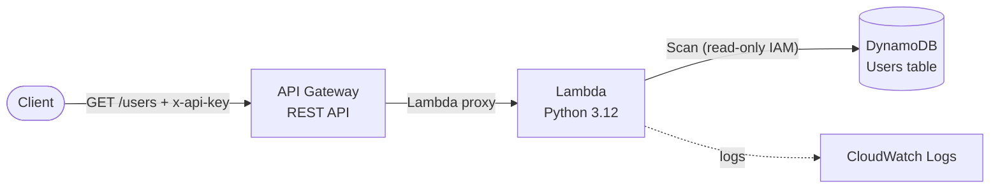

# Architecture

The same diagram is kept as a standalone file in [`architecture.mmd`](architecture.mmd).

## Components

| Component | Role |
|-----------|------|
| **API Gateway (REST)** | Public HTTPS entry point. Requires an API key and applies throttling via a usage plan. |
| **Lambda (`src/handler.py`)** | Validates input, reads from DynamoDB, formats the proxy response. |
| **DynamoDB** | On-demand table with partition key `userId` (string), encryption at rest and point-in-time recovery. |
| **CloudWatch Logs** | Lambda logs; internal errors are logged here and never returned to clients. |

## Request flow

1. The client calls `GET /users` with an `x-api-key` header.
2. API Gateway checks the key and throttle limits, then invokes the Lambda (proxy integration).
3. The Lambda validates `limit` (1-100, default 25) and the optional `nextToken`.
4. It performs a `Scan` with `Limit` (and `ExclusiveStartKey` when paginating).
5. The response contains `users`, `count`, `hasMore` and, if more data exists, a `nextToken`.

## Design decisions

- **Scan vs Query:** the handler uses `Scan` because it returns every user and the table has a simple key schema. For large tables, replace it with a `Query` on a purpose-built key or GSI.
- **Pagination:** DynamoDB's `LastEvaluatedKey` is base64-encoded into an opaque `nextToken`. A `Scan` page can contain fewer items than `limit`, so rely on `hasMore`, not `count`.
- **Both event formats:** the handler accepts REST API (v1) and HTTP API (v2) events.
- **ARM64 + Python 3.12:** cheaper and faster for this workload; boto3 ships with the runtime, so there is nothing to package.
